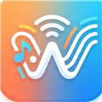

# SonicWave — a self-hosted music player for iOS, iPadOS, and macOS

<div align="center">

  

  <br/>

  [](https://github.com/alzimerahmed/SonicWave)
  [](https://swift.org)
  [](LICENSE)

  **Stream your own music. Any Ampache or Subsonic API server, one polished native app.**

  [Features](#features) ·
  [Screenshots](#screenshots) ·
  [Tech Stack](#tech-stack) ·
  [Building](#building) ·
  [Usage](#usage) ·
  [Roadmap](#roadmap) ·
  [License](#attribution--license) ·
  [Contributing](#contributing)

</div>

SonicWave is a GPLv3 music streaming client for self-hosted servers, forked from
[Amperfy](https://github.com/BLeeEZ/amperfy). It speaks the **Ampache API** and the
**Subsonic/OpenSubsonic API**, so it works out of the box with Ampache, Navidrome,
Gonic, Airsonic, Funkwhale, Nextcloud Music, and most other Subsonic-compatible servers.

## Features

**Servers & library**
- Ampache API and Subsonic/OpenSubsonic API support
- Multiple accounts — switch between servers without re-syncing
- Music, podcasts, and internet radio in one library
- Server-side scrobbling, 5-star ratings, and favorites synced back to the server
- Lyrics via OpenSubsonic (`getLyricsBySongId` + structured lyrics extension)
- Custom HTTP headers per account (e.g. Cloudflare Access service tokens)
- Configurable Home tab sections

**Playback**
- Gapless playback for supported formats
- 10-band parametric equalizer (32 Hz – 16 kHz, ±6 dB) with presets, custom curves, and automatic gain compensation
- Replay gain
- Sleep timer
- Audio visualizers: spectrum bars, waveform, and generative art
- Player colors adapt to album artwork

**Offline**
- Download songs, albums, playlists, and podcast episodes for offline playback
- Dedicated offline mode — cached-only browsing when you're off the grid

**Platform integration**
- CarPlay
- Siri media commands, Siri Shortcuts, and App Intents
- `x-callback-url` automation (`sonicwave://`)
- iOS, iPadOS, and macOS (Mac Catalyst) from a single codebase
- Six tint themes (blue, green, red, yellow, orange, purple) with light/dark variants

## Screenshots

> Screenshots currently show the upstream Amperfy UI; SonicWave-branded captures land with the visual rebrand.

### iOS

 &nbsp;
 &nbsp;


### macOS (Catalyst)


## Tech Stack

| Layer | Technology |
|---|---|
| Language | Swift 6 (strict concurrency complete) |
| UI | UIKit (storyboards/XIBs) + SwiftUI (settings) |
| Audio engine | [AudioStreaming](https://github.com/dimitris-c/AudioStreaming) + AVFoundation; parametric EQ, replay gain, FFT visualizers |
| Networking | [Alamofire](https://github.com/Alamofire/Alamofire); Ampache XML + Subsonic/OpenSubsonic API clients |
| Persistence | Core Data — 49-version staged migration chain |
| Layout | [SnapKit](https://github.com/SnapKit/SnapKit) + Interface Builder |
| Platform | iOS 26+, iPadOS, macOS via Catalyst; CarPlay + Siri/App Intents entitlements |
| Dependencies | Swift Package Manager (pinned in `Package.resolved`) |
| Tooling | Xcode 26+, [SwiftFormat](https://github.com/nicklockwood/SwiftFormat) (Google Swift style) |
| Tests | XCTest — `SonicWaveKitTests` |

### Project structure

```
SonicWave/
├── SonicWave.xcodeproj/    # Xcode project — targets: SonicWave, SonicWaveKit, SonicWaveKitTests
├── SonicWave/              # App shell: UIKit screens, SwiftUI settings, CarPlay, App Intents
│   ├── Intents/            #   App Intents, x-callback-url registration, Siri handling
│   ├── CarPlay/            #   CarPlay scene + tab templates
│   └── SwiftUI/            #   Settings UI
├── SonicWaveKit/           # Core framework — all logic lives here
│   ├── Api/                #   Ampache + Subsonic/OpenSubsonic clients, parsers, syncers
│   ├── Player/             #   Audio engine, EQ, replay gain, scrobbler, visualizers
│   ├── Storage/            #   Core Data stack + settings (49-version staged migrations)
│   ├── Download/           #   Background download manager
│   └── Assets/             #   Icons, theme artwork, custom SF Symbols
├── SonicWaveKitTests/      # Unit tests: API parsers, player, storage
├── BuildTools/           # SwiftFormat tooling (applyFormat.sh)
└── Helper/               # License-header scripts
```

## Building

Requirements: **Xcode 26+** (iOS 26 SDK), macOS. SPM dependencies resolve automatically.

1. Clone the repository:
   ```sh
   git clone https://github.com/alzimerahmed/SonicWave.git
   cd SonicWave
   ```
2. Open `SonicWave.xcodeproj` in Xcode.
3. Select the **SonicWave** scheme and build & run (⌘R).

<details>
<summary><strong>CarPlay & Siri entitlements on physical devices</strong></summary>

`SonicWave/SonicWave.entitlements` contains `com.apple.developer.carplay-audio` and
`com.apple.developer.siri`, which require Apple-approved provisioning profiles.
The simulator works as-is. To build on a device without those entitlements,
clear the entries in `SonicWave/SonicWave.entitlements` — the app runs fine without
CarPlay and Siri.

</details>

<details>
<summary><strong>Running the tests</strong></summary>

In Xcode: select the **SonicWave** scheme and press ⌘U.

From the command line:

```sh
xcodebuild -scheme SonicWave \
  -destination 'platform=iOS Simulator' \
  test -only-testing:SonicWaveKitTests
```

Running tests also applies the project's [SwiftFormat](https://github.com/nicklockwood/SwiftFormat)
style ([Google Swift Style Guide](https://google.github.io/swift), configured in `.swiftformat`).
To format manually: `./BuildTools/applyFormat.sh`.

</details>

## Usage

**Connect to a server** (Navidrome used as an example — the flow is identical for
Ampache or any Subsonic-compatible server):

1. Open **Settings → Accounts → +** and choose **Subsonic**.
2. Enter your server URL (`https://music.example.com`), username, and password.
3. SonicWave verifies the connection, then syncs your library in the background.
   Downloads, ratings, and scrobbling are per-account — add a second server any time.

**Automate playback via `x-callback-url`:**

```
sonicwave://x-callback-url/searchAndPlay?searchTerm=Awesome&searchCategory=playlist
```

Registered actions include `searchAndPlay`, `playID`, `playRandomSongs`, `play`,
`pause`, `togglePlayPause`, `playNext`, `playPreviousOrReplay`, `setShuffle`,
`setRepeat`, `setOfflineMode`, `rateCurrentlyPlayingSong`, and
`favoriteCurrentlyPlayingSong`. The full action list with parameters is browsable
in-app under **Settings → x-callback URLs**, and defined in
`SonicWave/Intents/IntentManager.swift`.

## Roadmap

Planned, in no strict order — contributions welcome:

- [x] Rebrand to the SonicWave identity (project/target names, bundle ID, icon, URL scheme)
- [ ] Time-synced lyrics view (OpenSubsonic structured lyrics)
- [ ] Automatic download sync (keep favorites and playlists offline without manual action)
- [ ] Discovery surface: smart mixes and recommendations on the Home tab
- [ ] Home Screen widgets and Live Activities
- [ ] watchOS companion app
- [ ] Smart playlists (rule-based local playlists)

## Attribution & License

SonicWave is a fork of **[Amperfy](https://github.com/BLeeEZ/amperfy)** by
**Maximilian Bauer** ([@BLeeEZ](https://github.com/BLeeEZ)). All upstream copyright
and attribution are preserved as required by the license. SonicWave is maintained
by **Alzimer Ahmed**.

SonicWave is licensed under the
**[GNU General Public License v3](LICENSE)** — the same license as upstream Amperfy.
If you distribute modified versions, you must keep the upstream attribution and
license your changes under GPLv3.

### Third-party dependencies

| Dependency | Purpose | License |
|---|---|---|
| [AudioStreaming](https://github.com/dimitris-c/AudioStreaming) | Streaming audio engine | MIT |
| [Alamofire](https://github.com/Alamofire/Alamofire) | HTTP networking | MIT |
| [SnapKit](https://github.com/SnapKit/SnapKit) | Auto Layout DSL | MIT |
| [MarqueeLabel](https://github.com/cbpowell/MarqueeLabel) | Scrolling labels | MIT |
| [NotificationBanner](https://github.com/Daltron/NotificationBanner) | In-app banners | MIT |
| [ID3TagEditor](https://github.com/chicio/ID3TagEditor) | ID3 tag parsing | MIT |
| [CallbackURLKit](https://github.com/phimage/CallbackURLKit) | x-callback-url handling | MIT |
| [Ifrit](https://github.com/ukushu/Ifrit) | Fuzzy search | MIT |
| [VYPlayIndicator](https://github.com/obrhoff/VYPlayIndicator) | Now-playing indicator | MIT |
| [DominantColors](https://github.com/DenDmitriev/DominantColors) | Artwork-adaptive colors | MIT |
| [AudioVisualizerKit](https://github.com/Kyome22/AudioVisualizerKit) | FFT audio analysis (vendored) | MIT |
| [iOS-swiftUI-spotify-equalizer](https://github.com/urvi-k/iOS-swiftUI-spotify-equalizer) | Visualizer reference (vendored) | MIT |
| [swift-collections](https://github.com/apple/swift-collections) | Data structures | Apache-2.0 |
| [ogg-binary-xcframework](https://github.com/sbooth/ogg-binary-xcframework) / [vorbis-binary-xcframework](https://github.com/sbooth/vorbis-binary-xcframework) | Ogg/Vorbis playback | BSD |
| [CoreDataMigrationRevised-Example](https://github.com/wibosco/CoreDataMigrationRevised-Example) | Staged-migration technique reference | MIT |

**Special thanks:** [Dirk Hildebrand](https://apps.apple.com/us/developer/dirk-hildebrand/id654444924)

## Contributing

Pull requests are welcome.

- `SonicWaveKitTests` must pass before merging.
- Code style is enforced by SwiftFormat ([Google Swift Style Guide](https://google.github.io/swift)); run `./BuildTools/applyFormat.sh` or just run the tests.
- Commit messages follow [Conventional Commits](https://www.conventionalcommits.org).
- GPLv3: contributions are licensed under GPLv3, and upstream Amperfy attribution must be preserved.
